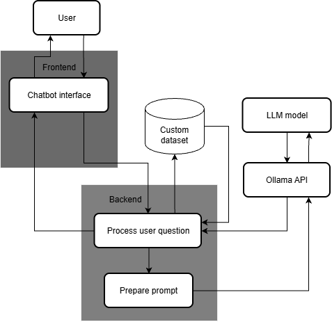

# CSC649 GROUP PROJECT - GROUP 7

## 1. Project Title
### InterviewCoach - Interview Assistant

InterviewCoach is a domain-specific chatbot designed to help candidates in preparing for IT job interviews. The chatbot provides interview questions, suggested answers and useful tips related to the interview process.

It can be challenging to prepare for an interview, particularly for those who are interviewing for their first job or for an IT related role. They might not be aware of the questions that may be asked or how to describe their skills and experiences.

Therefore, InterviewCoach was created to offer a simple method for users to practice answering interview questions and get ready for an actual interview.

## 2. Domain
This chatbot's domain is Human Resources (HR), with a focus on IT job interview preparation.

The chatbot aims to assist candidates who wish to practice frequently asked interview questions related to IT knowledge, technical skills, project experience, teamwork, and problem-solving.

## 3. Team Members

| No. | Name | GitHub Username | Role |
|---|---|---|---|
| 1 | Nurafiqah | @afiqah-farz | Project Leader |
| 2 | Umi | @UmiFatin | Frontend Developer |
| 3 | Famiza | @famizaamira | Backend Developer / Model Integrator |
| 4 | Arifah | @arifahnajmie | Domain Specialist |

## 4. How to Run
## 5. System Architecture

InterviewCoach consists of a frontend, backend, custom dataset and an LLM accessed through the Ollama API.

The frontend is the user interface where users can ask their questions and see the chatbot's answers. The backend processes the user's request and interacts with the LLM through the Ollama API.

When a user asks a question, the backend sends the question to the LLM. The model produces a response based on the prompt and the information provided to it. The answer is then sent back to the backend and display it in the frontend.

## 6. Dataset Description
The project uses a custom dataset containing interview questions and answers related to IT interview preparation.

The dataset is stored in CSV format and contains the following columns:
| Column | Description |
|---|---|
| Question | Interview question or IT-related question |
| Answer | Answer or explanation for the question |

The dataset contains 33 question-and-answer pairs covering topics such as:
- IT interview preparation
- Project experience
- Teamwork and deadlines
- Troubleshooting
- Basic IT knowledge
- Web development

The dataset is used to support the chatbot's responses during interview preparation.

The dataset file is located at:
data/interview_it_questions.csv

## 7. Model Details
InterviewCoach uses the Ollama API to communicate with a Large Language Model (LLM).

An LLM is an AI model that can read text prompts and produce reponses based on the information given. In this project, the model is used to answer the questions about IT interview preparation.

The Ollama API allows the backend to send user questions to the model and receive the generated responses. This allows the chatbot to provide answers through the application interface.

The model details are shown below:
| Component | Description |
|---|---|
| API | Ollama API |
| Model Type | |
| Model Name | |

## 8. Limitations

## 9. GenAI use
